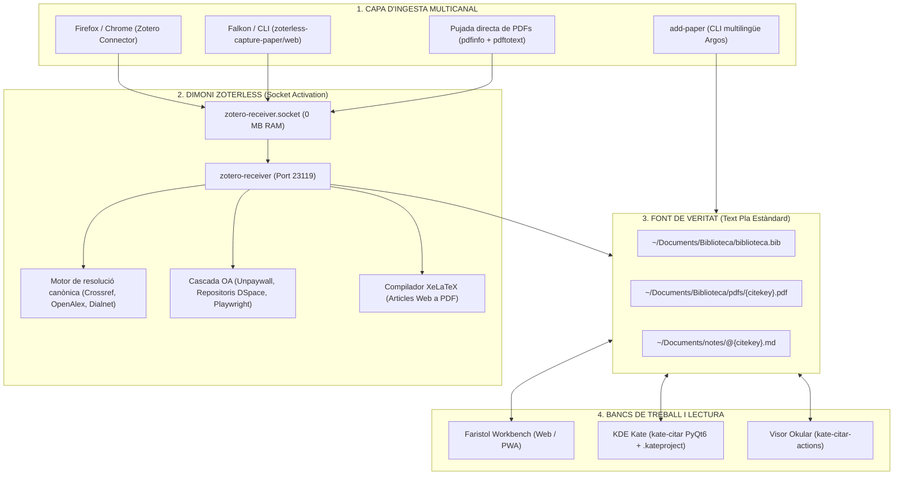

# ⚡ zoterless

> **Zero RAM en repòs (Socket Activation), Zero SQLite, Zero Electron/Gecko. 100% Zotero Connector Compatible.**  
> *Una suite acadèmica sobirana i minimalista basada en fitxers plans per a Linux (KDE Plasma 6, Kate, Okular, Faristol).*

---

## 🎯 La Filosofia: Les 4 Peces Essencials en un Sol Dimoni

Després d'acabar configurant al llarg dels anys una pila de treball molt concreta i potent al voltant de l'ecosistema Zotero:

1. **Zotero Connector:** La millor extensió de navegador del món acadèmic per capturar articles científics, tesis i llibres en un sol clic des de revistes, catàlegs o PDFs en línia. *(És una eina imprescindible i la continuem emprant exactament igual).*
2. **Better BibTeX (BBT):** El plugin clau per generar citekeys canòniques i predictibles (estil `autorTitolAny`) i mantindre sincronitzat un fitxer `.bib`.
3. **ZotMoov (o ZotFile):** El plugin imprescindible per extreure els fitxers de la base de dades interna, reanomenar automàticament els PDFs amb la citekey estàndard i moure'ls a la nostra carpeta de documents.
4. **Better Notes (Exportació Markdown):** El plugin per generar automàticament una plantilla de notes estructurada en Markdown amb metadades YAML i enllaços per a cada nova referència.

Em vaig plantejar poder implementar aquest flux de manera senzilla, adaptant-lo a les meues necessitats específiques, emprant les eines que més solc utilitzar (el navegador web Firefox/Falkon i l'editor Kate).

### 💥 La Paradoxa de la Pila Clàssica

Per gaudir d'aquestes 4 funcionalitats essencials, calia:

- Mantindre oberta permanentment una aplicació feixuga de més de **500 MB de RAM** (Zotero Desktop, construït sobre el motor Gecko/Firefox i una base de dades SQLite opaca).
- Configurar i mantindre **3 extensions de tercers en JavaScript**, que sovint es desincronitzen o es trenquen amb cada actualització major de Zotero (com va passar dolorosament amb el salt a Zotero 7).

### ⚡ La Solució `zoterless`

**`zoterless` aglutina i fon aquestes 4 peces en un sol servei autònom de 0 MB de RAM en repòs (mitjançant Systemd Socket Activation)**, sense dependències opaques:

- **100% Compatible amb Zotero Connector:** Continuem fent clic a la icona oficial del navegador a Firefox, Chrome o Brave. L'extensió envia la petició HTTP al port local `23119`, i `zotero-receiver` s'activa instantàniament a demanda i li respon amb el protocol natiu de Zotero.
- **Suport per a navegadors sense extensions (Falkon):** Mitjançant `zoterless-capture-paper` i `zoterless-capture-web`, integrat amb dreceres globals de teclat a l'escriptori.
- **Maquetació d'Articles Web a PDF (XeLaTeX):** Converteix articles de premsa, blogs i pàgines web (`saveSnapshot`, `saveSingleFile`) en **PDFs elegants d'alta qualitat tipogràfica** compilats amb XeLaTeX i la seua corresponent fitxa Markdown.
- **Better BibTeX natiu:** Resolució de metadades canòniques via Crossref/OpenAlex/DOI i escriptura directa a `~/Documents/Biblioteca/biblioteca.bib`.
- **ZotMoov natiu:** Descàrrega directa de PDFs en accés obert (Unpaywall, Dialnet, DSpace) o escaneig automàtic a `~/Downloads`, reanomenant a `{citekey}.pdf` a la carpeta `pdfs/`.
- **Better Notes natiu:** Creació immediata de la fitxa de recerca en Markdown amb frontmatter YAML a `~/Documents/notes/@{citekey}.md`.

---

## 🔄 Taula d'Equivalències (Pila Feixuga vs zoterless)

| La pila pesada anterior | L'alternativa zoterless | Què fa exactament? |
| :--- | :--- | :--- |
| **Zotero Connector** *(extensió navegador)* | **Zotero Connector** *(el mantenim!)* | Captura de metadades i PDFs al navegador en un sol clic. |
| **Zotero Desktop** *(~500 MB RAM, SQLite, Gecko)* | **`zotero-receiver`** *(0 MB RAM en repòs via Socket Activation)* | Servidor HTTP natiu en Python activat a demanda al port `23119`. |
| **Plugin Better BibTeX** *(motor JS intern)* | **Natiu a `zoterless`** | Citekeys canòniques (`autorTitolAny`) i escriptura a `biblioteca.bib`. |
| **Plugins ZotMoov / ZotFile** *(reanomenar PDFs)* | **Natiu a `zoterless`** | Descàrrega directa d'Unpaywall, Dialnet o detecció automàtica a `~/Downloads`. |
| **Plugins Better Notes / Markdown** | **Natiu a `zoterless`** | Creació immediata de la plantilla de notes a `notes/@{citekey}.md`. |
| **Captura de webs a HTML desordenat** | **Natiu a `zoterless` (XeLaTeX)** | Converteix pàgines i articles web en PDFs tipogràficament impecables. |
| **Navegador Falkon sense webextensions** | **`zoterless-capture-paper/web`** | Captura instantània via xdotool/clipboard amb dreceres de teclat. |
| **VS Code + Extensions Zotero** *(cercador de cites)* | **`kate-citar`** *(PyQt6 natiu per a Kate a Plasma 6)* | Cercador instantani de referències per inserir `@citekey` al cursor. |
| **Visor de PDFs intern de Zotero** | **`kate-citar-actions` + Okular** | Salt directe a la pàgina exacta i ressaltat de citació a Okular. |

---

## 🏗️ Arquitectura del Sistema



---

## ✨ Funcionalitats Clau

1. **Zero RAM en repòs (Systemd Socket Activation):**
   Mitjançant `zotero-receiver.socket`, el sistema no manté cap procés en segon pla consumint memòria. En rebre una petició HTTP al port `23119`, systemd desperta el dimoni en mil·lisegons, processa la referència i torna a l'estat de repòs.
2. **100% Compatible amb Zotero Connector:**
   Fes clic a la icona oficial del Zotero Connector a Firefox, Chrome o Brave com sempre. No cal tindre Zotero Desktop instal·lat ni obert.
3. **Suport per a Falkon i entorns minimalistes:**
   Els scripts `zoterless-capture-paper` i `zoterless-capture-web` permeten capturar articles i pàgines web des de navegadors lleugers com Falkon mitjançant dreceres de teclat globals o ordres de terminal.
4. **Articles Web a XeLaTeX PDF:**
   Quan es desa una pàgina web (`/connector/saveSnapshot` o `saveSingleFile`), `zoterless` en neteja el contingut, extreu metadades i el compila amb **XeLaTeX** en un PDF maquetat d'alta resolució, integrat a la carpeta de PDFs i a la base de dades.
5. **Ingesta de fitxers PDF locals:**
   Permet enviar fitxers PDF directament al receptor: n'inspecciona el contingut mitjançant `pdfinfo` i `pdftotext`, extreu el DOI o en dedueix el títol, i resol la referència canònica a Crossref/OpenAlex.
6. **Resolució d'Accés Obert Multi-Ubicació (Unpaywall + Repositoris):**
   Itera sobre totes les rèpliques d'accés obert disponibles, prioritzant servidors universitaris (RODERIC, RiuNet, Zenodo, HAL, PMC) per sobre de servidors comercials bloquejats per sistemes antibot.
7. **Normalització Unicode (NFKD):**
   Els cognoms i títols amb accents (`Cáceres`, `innovación`) es transliteren de manera natural (`caceresTendenciasInnovacion...`) sense caràcters estranys ni corrupció de claus BibTeX.
8. **Integració nativa amb KDE Plasma 6 i Kate:**
   Inclou `kate-citar` (selector de referències escrit en **PyQt6**) i `kate-sync-project` per actualitzar automàticament el projecte de Kate i permetre citar a l'instant.

---

## 📂 Estructura de Fitxers

`zoterless` organitza la teua biblioteca estrictament en fitxers estàndard de text pla:

```text
~/Documents/
├── Biblioteca/
│   ├── biblioteca.bib          # Base de dades canònica en text pla
│   └── pdfs/                   # PDFs organitzats per citekey
│       ├── pont-niclosCreativityArtificialIntelligence2024.pdf
│       ├── berzosaInteligenciaArtificialPensamiento2025.pdf
│       └── caceresTendenciasInnovacionCurricular2026.pdf
└── notes/
    ├── @pont-niclosCreativityArtificialIntelligence2024.md   # Nota bibliogràfica (@citekey)
    ├── @berzosaInteligenciaArtificialPensamiento2025.md      # Nota bibliogràfica (@citekey)
    ├── 20260920T120000--didactica-ciencies_educacio.md       # Nota pròpia (sense @)
    └── concepte-pensament-computacional.md                   # Nota pròpia (sense @)
```

> **🏷️ La Convenció de l'Arroba (`@`):**  
> Les notes que comencen per `@` (`@{citekey}.md`) són **notes bibliogràfiques** (*literature notes*): fitxes associades directament a un article, llibre o PDF extern generades automàticament per `zoterless`.  
> Les notes que **no** porten arroba són **notes pròpies o permanents** (*evergreen notes*): idees, síntesis o assajos elaborats totalment per nosaltres, que enllacen cap a la bibliografia mitjançant `[[@citekey]]` o la citació Pandoc `[@citekey, p. X]`.

---

## 🚀 Instal·lació

### 1. Requisits previs (Debian / Ubuntu / Kubuntu)

```bash
sudo apt install python3 python3-pyqt6 curl poppler-utils libnotify-bin texlive-xetex pandoc
```

### 2. Clonar i instal·lar

```bash
git clone https://github.com/CasimirVictoria/zoterless.git ~/Projects/zoterless
cd ~/Projects/zoterless
chmod +x install.sh
./install.sh
```

L'instal·lador:
- Enllaça els binaris a `~/.local/bin/` (`zotero-receiver`, `add-paper`, `kate-citar`, `kate-citar-actions`, `kate-sync-project`, `zoterless-capture-paper`, `zoterless-capture-web`).
- Copia i activa `zotero-receiver.socket` i `zotero-receiver.service` a `~/.config/systemd/user/`.
- **En repòs el consum és estrictament de 0 MB de RAM.**

---

## ⚙️ Arquitectura Systemd Socket Activation (0 MB RAM en Repòs)

`zoterless` aprofita la funcionalitat de **Socket Activation de systemd** per eliminar la necessitat de tindre servidors o interfícies pesades obertes permanentment a la memòria:

1. **`zotero-receiver.socket`:** systemd s'encarrega d'escoltar al port `0.0.0.0:23119` (tant en local com per la interfície de **Tailscale** per a Android). Com que és systemd qui manté el socket obert, **el consum de RAM de zoterless és de 0 MB**.
2. **`zotero-receiver.service`:** Quan fas clic a la icona de Zotero Connector a Firefox, envies un document des d'Android o deses una web amb SingleFile, systemd detecta el trànsit i desperta el servei en mil·lisegons (`python3 ~/.local/bin/zotero-receiver`), que processa la ingesta, actualitza els fitxers i torna a l'estat de repòs.

### Ordres de gestió amb Systemd

```bash
# 1. Habilitar i arrencar el socket d'escolta permanent
systemctl --user enable --now zotero-receiver.socket

# 2. Comprovar l'estat del socket d'escolta (sempre actiu)
systemctl --user status zotero-receiver.socket

# 3. Comprovar l'estat del servei de processament (s'activa a demanda)
systemctl --user status zotero-receiver.service

# 4. Veure els registres d'ingesta en viu (logs)
journalctl --user -u zotero-receiver -f

# 5. Reiniciar o aturar si cal aplicar canvis manuals
systemctl --user restart zotero-receiver.service
systemctl --user restart zotero-receiver.socket
```

---

## 🛠️ El Company de Consola: `add-paper`

Per a una experiència completa des del terminal, cerca federada o integració amb el portapapers, `zoterless` inclou el potent gestor **`add-paper`**:

```bash
# Ingesta per DOI o URL
add-paper 10.1016/j.compedu.2023.104845

# Cerca federada interactiva en 35 bases de dades (amb traducció local Argos):
add-paper -s "pensament computacional en educació primària"

# Compilació d'articles web a PDF d'alta qualitat (XeLaTeX):
add-paper -w https://cacm.acm.org/magazines/2024/2/computational-thinking/fulltext

# Connexió automàtica a EduVPN UV abans de la descàrrega:
add-paper --vpn 10.1016/j.compedu.2023.104845

# Captura autònoma des del portapapers (Wayland/X11):
add-paper
```

📖 **Consulta el [Manual Complet de add-paper](docs/add-paper.md)** per conèixer totes les opcions de línia d'ordres, llançadors d'escriptori i dreceres globals.

---

## 📱 Captura Remota des d'Android (mitjançant Tailscale)

Gràcies a la connexió xifrada punt a punt de **Tailscale**, pots enviar articles científics, pàgines web i PDFs des del teu telèfon mòbil directament cap a la biblioteca de l'ordinador estigues on estigues (amb dades 4G/5G, a la universitat o viatjant), **sense obrir ports al router ni exposar el teu ordinador a la xarxa pública**.

`zotero-receiver` incorpora un portal mòbil natiu i compatibilitat amb **Web Share Target (PWA)**:

```
┌─────────────────────────────────────────────────────────────┐
│                     ANDROID VIA TAILSCALE                   │
│                                                             │
│   Navegador / PDF / Apps          Extensió SingleFile       │
│      Menú "Compartir..."          (Firefox Android)         │
│               │                            │                │
│               ▼                            ▼                │
│       [Zoterless PWA]            REST API: /singlefile      │
└───────────────┼────────────────────────────┼────────────────┘
                │   (Xarxa segura WireGuard) │
                └──────────────┬─────────────┘
                               ▼
            ┌────────────────────────────────────┐
            │   zotero-receiver (:23119)         │
            │   - Resolució DOI / Crossref       │
            │   - Descàrrega PDF / XeLaTeX Web   │
            │   - Escriptura a biblioteca.bib    │
            │   - Generació de notes/@citekey.md │
            └────────────────────────────────────┘
```

### 1. Menú natiu «Compartir...» d'Android (Web Share Target / Hermit)
1. Obre `http://<IP-Tailscale>:23119` a Chrome, Firefox o millor com a **Lite App a Hermit**.
2. Afegeix-la a la pantalla d'inici com a aplicació web instal·lable (PWA).
3. **El superpoder:** Zoterless s'enregistra al sistema operatiu com a destinació directa al menú **«Compartir...» d'Android**.
4. Sempre que estigues llegint un article a qualsevol app (xarxes, premsa, correu, Telegram, lector de documents o navegador):
   - Toca **«Compartir»** → Selecciona **«Zoterless & Faristol»**.
   - Zoterless rep l'enllaç o el document en segon pla, resol el BibTeX canònic, en descarrega el PDF en accés obert, en crea la nota `@citekey.md` i t'envia la confirmació.

### 2. Portal Web Mòbil Dedicat (`/mobile`)
En obrir `http://<IP-Tailscale>:23119/` des del mòbil tens accés a una consola tàctil neta:
- **Camp directe per a URL o DOI:** enganxa qualsevol enllaç acadèmic o codi `10.xxxx/...` i prem *«Enviar a la Biblioteca»*.
- **Pujada directa de fitxers PDF:** puja qualsevol PDF emmagatzemat al mòbil; el servidor n'extraurà el DOI per `pdfinfo`/`pdftotext`, n'obtindrà les metadades oficials i l'arxivarà.
- **Accés directe amb un toc a Faristol:** botó per saltar a la teua biblioteca de lectura a `http://<IP-Tailscale>:8080`.

### 3. Captura Dual d'Articles Web amb SingleFile (HTML fidel + PDF XeLaTeX)
L'extensió **SingleFile** per a Firefox Android permet capturar articles de premsa, blogs i portals web generant simultàniament **dues versions documentals complementàries**:

1. **Configuració ràpida a Firefox Android:**
   - Obre les opcions de SingleFile (**Complements** ➔ **SingleFile** ➔ **Opcions**).
   - A la secció **Destination (Destinació)**: Tria **Upload to a REST Form API**.
   - **URL de destinació:** `http://<IP-Tailscale>:23119/singlefile`
   - **Camp de fitxer (Data field name):** `file`
   - **Camp d'URL (URL field name):** `url`
   - **Mètode HTTP:** `POST`
2. **Generació simultània triple:**
   - En tocar la icona de SingleFile al telèfon mòbil, `zoterless` processa la captura i genera:
     * **Snapshot HTML autèntic (`pdfs/{citekey}.html`):** arxiu web autocontingut complet amb imatges, fonts i maquetació original.
     * **Versió PDF XeLaTeX (`pdfs/{citekey}.pdf`):** compilat tipogràfic net per a impressió o lectura e-ink.
     * **Nota Markdown (`notes/@{citekey}.md`):** amb el text extret, resum i metadades YAML.
     * **Registre canònic a `biblioteca.bib`:** amb ambdues fonts indexades.
3. **Lectura, subratllat i sincronització a Faristol:**
   - A **Faristol** (`:8080`), l'Snapshot HTML es visualitza directament al panell central.
   - Pots **subratllar text** (persistent amb `mark.faristol-highlight`) i prémer **«Citar»** al menú flotant per injectar fragments directament a la teua nota.
   - Les citacions a la nota mantenen un **enllaç dinàmic bidireccional**: en fer-hi clic, Faristol fa scroll suau fins al paràgraf exacte de l'HTML.

---

## ⚙️ Integració amb l'Editor Kate (KDE Plasma 6)

### 1. Inserir citació (`kate-citar`)

- A Kate: **Configuració** → **Configura Kate** → **Eines externes** → **Afegeix**.
- **Nom:** `Citar BibTeX`
- **Ordre:** `kate-citar`
- **Drecera recomanada:** `Ctrl+Alt+C`
- En prémer la drecera, s'obre un cercador ràpid en PyQt6. En triar una entrada i prémer `Enter`, s'insereix `@citekey` directament al text.

### 2. Menú d'accions contextuals (`kate-citar-actions`)

- A Kate: **Eines externes** → **Afegeix**.
- **Nom:** `Accions de Citació`
- **Ordre:** `kate-citar-actions %{Document:Selection:Text}`
- **Drecera recomanada:** `Ctrl+Alt+O`
- Situa el cursor sobre qualsevol `@citekey`:
  - **Obrir PDF:** Obre el PDF canònic a **Okular**.
  - **Obrir Nota:** Obre la nota Markdown (`@{citekey}.md`) en una pestanya de **Kate**.

---

## 🧬 Ecosistema i Integració: zoterless + Faristol + mcp-server-academic-spain

`zoterless` forma part d'un ecosistema sobirà dissenyat segons la **filosofia UNIX**:

1. **`zoterless`:** El dimoni d'ingesta ràpida (0 MB RAM en repòs).
2. **`Faristol`:** El banc de treball de lectura de PDFs a 3 plafons amb visor PDF.js, editor Markdown, xat amb Antigravity IA i NotebookLM.
3. **`mcp-server-academic-spain`:** El servidor MCP de cerca federada en 35 bases de dades per a agents d'intel·ligència artificial.

---

## ⚖️ Política d'Accés Obert i Resolució Externa de Documents

`zoterless` està compromès de forma estricta amb la **ciència oberta (*Open Access*)** i el respecte als marcs legals i de drets d'autor:
- El sistema utilitza exclusivament fonts legals d'accés obert: **Unpaywall API**, **OpenAlex**, **Dialnet**, **arXiv**, metadades de **Crossref** i repositoris institucionals universitaris (OJS, DSpace, RODERIC).
- Aquest repositori no incorpora ni distribueix connectors ni resolutors cap a portals no autoritzats. Gràcies a l'ús de fitxers plans estàndard (`biblioteca.bib` i carpeta `pdfs/`), l'usuari manté el control total de la seua biblioteca.

---

## ⚠️ Avís de Responsabilitat i Projecte Personal

Aquest és un **projecte personal**, concebut artesanalment per donar resposta a un flux de treball concret de recerca acadèmica:
- **Sense garanties (*AS-IS*):** Distribuït sota llicència MIT de manera lliure i comunitària, «tal com és», sense cap garantia explícita ni implícita.
- **Exempció de responsabilitat:** L'autor no es fa responsable de cap possible pèrdua d'informació, alteració de fitxers o fallades del sistema. Recomanem mantindre còpies de seguretat periòdiques dels vostres fitxers (`notes/`, `pdfs/` i `biblioteca.bib`).

---

## 🤖 Autoria i Desenvolupament amb Antigravity CLI

- **Concepció, visió del flux i necessitats d'investigació:** Casimir Victoria (@CasimirVictoria).
- **Arquitectura i implementació del codi:** Creat, programat i afinat íntegrament en programació en parella (*pair programming*) emprant l'agent d'intel·ligència artificial **Antigravity CLI** (`agy`) de Google DeepMind.

> *"Aquest programari ha nascut de la necessitat pràctica d'un flux de treball acadèmic fluid, sobirà i basat estrictament en text pla. Casimir n'ha aportat les idees, l'experiència d'usuari i la direcció del disseny; la programació i la implementació tècnica del codi han estat dutes a terme amb Antigravity CLI."*

---

## 📄 Llicència

Distribuït sota la llicència [MIT](LICENSE). Desenvolupat amb passió pel programari lliure i la simplicitat de UNIX.
