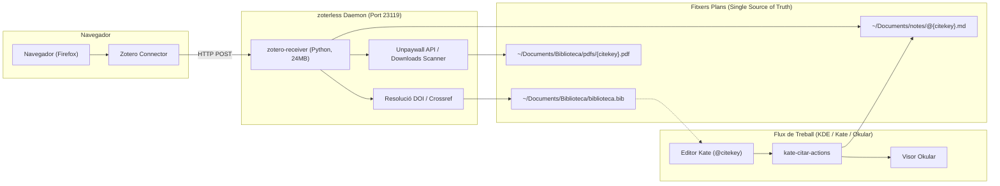
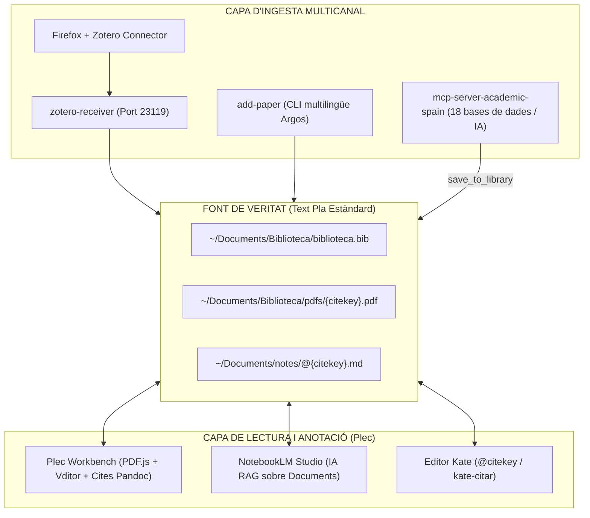

# ⚡ zoterless

> **Zero RAM, Zero SQLite, Zero Electron/Gecko. 100% Zotero Connector Compatible.**  
> *Una suite acadèmica minimalista basada en fitxers plans per a Linux (KDE Plasma, Kate, Okular).*

---

## 🎯 La Filosofia: Les 4 Peces Essencials en un Sol Dimoni

Després d'acabar configurant al llarg dels anys una pila de treball molt concreta i potent al voltant de l'ecosistema Zotero:

1. **Zotero Connector:** La millor extensió de navegador del món acadèmic per capturar articles científics, tesis i llibres en un sol clic des de revistes, catàlegs o PDFs en línia. *(És una eina imprescindible i la continuem emprant exactament igual).*
2. **Better BibTeX (BBT):** El plugin clau per generar citekeys canòniques i predictibles (estil `autorTitolAny`) i mantindre sincronitzat un fitxer `.bib`.
3. **ZotMoov (o ZotFile):** El plugin imprescindible per extreure els fitxers de la base de dades interna, reanomenar automàticament els PDFs amb la citekey estàndard i moure'ls a la nostra carpeta de documents.
4. **Better Notes (Exportació Markdown):** El plugin per generar automàticament una plantilla de notes estructurada en Markdown amb metadades YAML i enllaços per a cada nova referència.

Em vaig plantejar poder implementar aquest fluxe de manera senzilla, adaptant-lo a les meus necessitats específiques, emprant les eines que més solc emprar (el navegador web firefox i l'editor kate).

### 💥 La Paradoxa de la Pila Clàssica

Per gaudir d'aquestes 4 funcionalitats essencials, havia de:

- Mantindre oberta permanentment una aplicació feixuga de més de **500 MB de RAM** (Zotero Desktop, construït sobre el motor Gecko/Firefox i una base de dades SQLite opaca).
- Configurar i mantindre **3 extensions de tercers en JavaScript**, que sovint es desincronitzen o es trenquen amb cada actualització major de Zotero (com va passar dolorosament amb el salt a Zotero 7).

### ⚡ La Solució `zoterless`

**`zoterless` aglutina i fon aquestes 4 peces en un sol dimoni autònom de ~24 MB en Python pur**, sense dependències opaques:

- **100% Compatible amb Zotero Connector:** Continuem fent clic a la icona oficial del navegador a Firefox. L'extensió envia la petició HTTP al port local `23119`, i `zotero-receiver` li respon amb el protocol natiu de Zotero.
- **Better BibTeX natiu:** Resolució de metadades canòniques via Crossref/DOI i escriptura directa a `~/Documents/Biblioteca/biblioteca.bib`.
- **ZotMoov natiu:** Descàrrega directa de PDFs en accés obert (Unpaywall, Dialnet, DSpace) o escaneig automàtic a `~/Downloads`, reanomenant a `{citekey}.pdf` a la carpeta `pdfs/`.
- **Better Notes natiu:** Creació immediata de la fitxa de recerca en Markdown amb frontmatter YAML a `~/Documents/notes/@{citekey}.md`.

---

## 🔄 Taula d'Equivalències (Pila Feixuga vs zoterless)

| La pila pesada anterior | L'alternativa zoterless | Què fa exactament? |
| :--- | :--- | :--- |
| **Zotero Connector** *(extensió navegador)* | **Zotero Connector** *(el mantenim!)* | Captura de metadades i PDFs al navegador en un sol clic. |
| **Zotero Desktop** *(~500 MB RAM, SQLite, Gecko)* | **`zotero-receiver`** *(~24 MB RAM, 0% CPU)* | Servidor HTTP natiu en Python al port `23119` que atén el Connector. |
| **Plugin Better BibTeX** *(motor JS intern)* | **Natiu a `zoterless`** | Citekeys canòniques (`autorTitolAny`) i escriptura a `biblioteca.bib`. |
| **Plugins ZotMoov / ZotFile** *(reanomenar PDFs)* | **Natiu a `zoterless`** | Descàrrega directa d'Unpaywall o detecció automàtica a `~/Downloads`. |
| **Plugins Better Notes / Markdown** | **Natiu a `zoterless`** | Creació immediata de la plantilla de notes a `notes/@{citekey}.md`. |
| **VS Code + Extensions Zotero** *(cercador de cites)* | **`kate-citar`** *(PyQt5 natiu per a Kate)* | Cercador instantani de referències per inserir `@citekey` al cursor. |
| **Visor de PDFs intern de Zotero** | **`kate-citar-actions` + Okular** | Obre el PDF associat a **Okular** i la nota a **Kate** amb una drecera. |

---

## 🏗️ Arquitectura del Sistema



---

## ✨ Funcionalitats Clau

1. **100% Compatible amb Zotero Connector:**
   Fes clic a la icona oficial del Zotero Connector a Firefox com sempre. No cal tindre Zotero obert ni instal·lat.
2. **Resolució intel·ligent de DOI & Metadades Canòniques:**
   Quan afegeixes un article des de catàlegs de biblioteques (com Trobes UV, Primo VE, Dialnet) on les dades solen arribar incompletes, `zoterless` neteja el títol, consulta l'API de Crossref i obté les metadades oficials i canòniques de la revista.
3. **Descàrrega automàtica de PDFs en Accés Obert:**
   Mitjançant la integració nativa amb l'API d'**Unpaywall**, descarrega automàticament el PDF lliure i el reanomena a `pdfs/{citekey}.pdf`.
4. **Detecció intel·ligent a `~/Downloads`:**
   Si l'article requereix accés per subscripció universitària (EduVPN) i el descarregues tu mateix, `zoterless` examina els PDFs recents a la teua carpeta de descàrregues, n'analitza la primera pàgina amb `pdftotext` i l'associa automàticament.
5. **Captura des del visor de PDFs de Firefox:**
   Si estàs veient un PDF en línia o un fitxer local `file:///...` al navegador, només has de prémer la icona de Zotero Connector: el sistema n'extrau el DOI de la capçalera i en registra totes les metadades.
6. **Normalització Unicode (NFKD):**
   Els cognoms i títols amb accents (`Cáceres`, `innovación`) es transliteren de manera natural (`caceresTendenciasInnovacion...`) sense perdre caràcters ni corrompre les claus BibTeX.
7. **Notificacions Natives KDE:**
   Notificació d'escriptori immediata mitjançant `notify-send` informant de la citekey, l'estat del PDF i la nota creada.

---

## 📂 Estructura de Fitxers

`zoterless` organitza la teua biblioteca estrictament en fitxers estàndard:

```text
~/Documents/
├── Biblioteca/
│   ├── biblioteca.bib          # Base de dades canònica en text pla
│   └── pdfs/
│       ├── pont-niclosCreativityArtificialIntelligence2024.pdf
│       ├── berzosaInteligenciaArtificialPensamiento2025.pdf
│       └── caceresTendenciasInnovacionCurricular2026.pdf
└── notes/
    ├── @pont-niclosCreativityArtificialIntelligence2024.md
    ├── @berzosaInteligenciaArtificialPensamiento2025.md
    └── @caceresTendenciasInnovacionCurricular2026.md
```

---

## 🚀 Instal·lació

### 1. Requisits previs (Debian / Ubuntu / Kubuntu)

```bash
sudo apt install python3 python3-pyqt5 curl poppler-utils libnotify-bin
```

### 2. Clonar i instal·lar

```bash
git clone https://github.com/CasimirVictoria/zoterless.git ~/Projects/zoterless
cd ~/Projects/zoterless
chmod +x install.sh
./install.sh
```

L'instal·lador:

- Copia els binaris a `~/.local/bin/`.
- Configura i activa el servei d'usuari a `systemd` (`zotero-receiver.service`).
- El servei arrenca automàticament a cada inici de sessió consumint només **~24 MB**.

---

## ⚙️ Integració amb l'Editor Kate

Per a una experiència de recerca fluida a KDE Plasma:

### 1. Inserir citació (`kate-citar`)

- A Kate: **Configuració** → **Configura Kate** → **Eines externes** → **Afegeix**.
- **Nom:** `Citar BibTeX`
- **Ordre:** `kate-citar`
- **Drecera recomanada:** `Ctrl+Alt+C`
- En prémer la drecera, s'obre un cercador ràpid en PyQt5. En triar una entrada i prémer `Enter`, s'insereix `@citekey` directament al text.

### 2. Menú d'accions contextuals (`kate-citar-actions`)

- A Kate: **Eines externes** → **Afegeix**.
- **Nom:** `Accions de Citació`
- **Ordre:** `kate-citar-actions %{Document:Selection:Text}`
- **Drecera recomanada:** `Ctrl+Alt+O`
- Situa el cursor sobre qualsevol `@citekey` (o selecciona-la):
  - **Obrir PDF:** Obre el PDF canònic a **Okular**.
  - **Obrir Nota:** Obre la nota Markdown (`@{citekey}.md`) en una pestanya de **Kate**.

---

## 🛠️ Eines Addicionals

### `add-paper`: Gestor CLI i Cerca Federada Multilingüe

Permet afegir articles i cercar literatura acadèmica directament des del terminal o el portapapers (Wayland/X11):

```bash
# 1. Cerca federada multilingüe (OpenAlex, ERIC, Crossref, Dialnet) amb Argos Translate:
#    Tradueix localment català -> anglès (ERIC, OpenAlex, Crossref) i castellà (Dialnet),
#    executa cerques en paral·lel, deduplica resultats i mostra fonts combinades:
add-paper -s "pensament computacional a primària"

# 2. Afegir directament per DOI, arXiv o URL de repositori (Dialnet, RODERIC, RiuNet, etc.):
add-paper 10.18172/con.6302
add-paper https://arxiv.org/abs/2301.00001
add-paper https://dialnet.unirioja.es/servlet/articulo?codigo=6327318

# 3. Descàrrega directa especificant la URL del PDF (descoberta per cercadors o repositoris):
add-paper --pdf-url https://dialnet.unirioja.es/descarga/articulo/6327318.pdf 10.18172/con.6302

# 4. Connectar automàticament a EduVPN UV abans de la descàrrega per a articles de pagament:
add-paper --vpn 10.1016/j.compedu.2023.104845

# 5. Mode autònom des del portapapers (llegeix automàticament el text copiat):
add-paper
```

### 🔍 Resolució en Accés Obert Multi-Ubicació (100% Legal)

Tant `zotero-receiver` (en fer clic al navegador) com `add-paper` incorporen una cascada de descàrrega legal d'alta precisió:
1. **Unpaywall Multi-Location:** Itera sobre la totalitat de `oa_locations` del registre, prioritzant les versions allotjades en dipòsits institucionals universitaris (RODERIC UV, RiuNet UPV, Zenodo, PubMed Central) per sobre de les còpies d'editorial sovint bloquejades.
2. **OpenAlex API (250M+ obres):** Resolució alternativa d'accés obert creuant metadades a través de `best_oa_location`, `primary_location` i `locations`.
3. **Repositoris Nacionals i OJS:** Descàrrega directa des de dominis universitaris espanyols (Dialnet, CSIC, RACO, TDX).

### 🔒 Detecció Institucional d'EduVPN

Quan un article pertany a una editorial sota subscripció (ScienceDirect, Springer, Wiley, IEEE, etc.) i no té PDF lliure en accés obert, `zoterless` comprova l'estat d'EduVPN (`nmcli`):

- Si la VPN institucional no està activa, envia una notificació suggerint connectar-la (`nmcli con up eduvpn`).
- Suporta descàrrega directa a través del túnel VPN WireGuard un cop connectat.

---

## 🧬 Ecosistema i Integració: zoterless + Plec + mcp-server-academic-spain

`zoterless` està dissenyat segons la **filosofia UNIX: fes una sola cosa i fes-la a la perfecció**. En lloc de convertir-se en un monòlit que ho faça tot, s'integra de forma nativa i desacoblada amb **[Plec](https://github.com/CasimirVictoria/plec)** (el banc de treball de lectura, anotació de PDFs i notes bibliogràfiques) i amb **[mcp-server-academic-spain](https://github.com/CasimirVictoria/mcp-server-academic-spain)** (el servidor MCP de cerca acadèmica federada en 18 bases de dades):



### Com es comuniquen els projectes:

1. **Font de veritat única en text pla:**
   - Tots els components comparteixen exactament els mateixos fitxers: `biblioteca.bib` per a les referències BibTeX, la carpeta `pdfs/{citekey}.pdf` per als documents, i `notes/@{citekey}.md` per a les fitxes d'estudi amb frontmatter YAML.
2. **Ingesta transparent per a Plec:**
   - Quan fas clic a la icona de Zotero Connector a Firefox, `zotero-receiver` processa la descàrrega, genera la referència BibTeX i crea la nota `@citekey.md`. Quan obris o recarregues `Plec`, tant el PDF com la seua nota d'estudi apareixen a l'instant llestos per a la lectura.
3. **Cerca i importació des de Plec:**
   - La interfície web de `Plec` incorpora la pestanya **[ 🌐 Cerca ]** connectada a `mcp-server-academic-spain` i a `add-paper`: permet cercar en 18 bases de dades i, amb el botó d'importació en un sol clic, cridar `add-paper --pdf-url` per afegir el document automàticament a la biblioteca.
4. **Pont d'Intel·ligència Artificial (`mcp-server-academic-spain`):**
   - El servidor MCP permet a qualsevol agent d'IA cercar en 18 bases de dades i desar directament articles a la biblioteca local `zoterless` i `Plec`.
5. **Zero dependència mútua (*No vendor lock-in*):**
   - Si Plec no està obert, `zoterless` funciona al 100% de la seua potència. Si `zoterless` actualitza un fitxer, Plec i Kate el detecten a l'instant.

---

## ⚖️ Política d'Accés Obert i Resolució Externa de Documents

`zoterless` està compromès de forma estricta amb la **ciència oberta (*Open Access*)** i el respecte als marcs legals i de drets d'autor:

- El sistema només utilitza de forma nativa fonts públiques i legals d'accés obert: **Unpaywall API**, **OpenAlex**, **Dialnet**, **arXiv**, metadades de **Crossref** i repositoris institucionals (OJS, DSpace, RODERIC).
- Per motius ètics, legals i de compliment de la propietat intel·lectual en diverses jurisdiccions, **aquest repositori no incorpora ni distribueix connectors ni resolutors cap a fonts no oficials com Sci-Hub**.
- Tanmateix, gràcies a l'arquitectura oberta basada en fitxers plans estàndard (`biblioteca.bib` i carpeta `pdfs/`), qualsevol investigador pot complementar el flux creant de forma autònoma scripts externs senzills (per exemple amb `curl` o Python) per gestionar descàrregues des de les seues pròpies fonts o subscripcions institucionals i col·locar els PDFs a `pdfs/{citekey}.pdf`.

---

## 🙏 Agraïments i Reconeixements

Aquest projecte és un tribut sincer al programari lliure i s'alça directament sobre les espatlles dels gegants que han definit el flux de treball acadèmic modern:

- A l'equip de **Zotero** i de la Corporation for Digital Scholarship pel seu insubstituïble **Zotero Connector**, que continua sent la millor eina del món per capturar literatura científica directament des del navegador.
- A **Emiliano Heyns** (*retorquere*) pel monumental treball d'enginyeria amb **Better BibTeX (BBT)**, el referent absolut de com han de ser les claus de citació canòniques i predictibles.
- Als desenvolupadors de **ZotMoov** i **ZotFile**, pioners en la idea d'extreure i reanomenar PDFs per alliberar-los de bases de dades tancades.
- A l'autor de **Better Notes**, per mostrar el camí cap a la integració atòmica entre literatura acadèmica i notes en Markdown.
- Als projectes de ciència oberta i eines lliures: **OpenAlex**, **Crossref**, **ERIC (IES)**, **Dialnet**, **Unpaywall** i **Argos Translate**.

### 🤖 Autoria i Desenvolupament

- **Concepció, visió del flux i necessitats d'investigació:** Casimir Victoria (@CasimirVictoria).
- **Implementació tècnica i desenvolupament del codi:** Creat i afinat en programació en parella (*pair programming*) amb l'agent d'intel·ligència artificial **Antigravity** de Google DeepMind.

> *"Aquest programari ha nascut de la necessitat pràctica d'un flux de treball acadèmic fluid, sobirà i basat estrictament en text pla. Jo he aportat les idees, l'experiència d'usuari i la direcció del disseny; la programació i la implementació tècnica del codi han estat dutes a terme per Antigravity."* — Casimir Victoria

---

## 📄 Llicència

Distribuït sota la llicència [MIT](LICENSE). Desenvolupat amb passió pel programari lliure i la simplicitat de UNIX.
