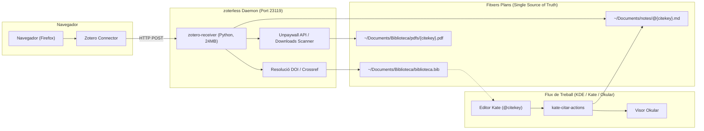
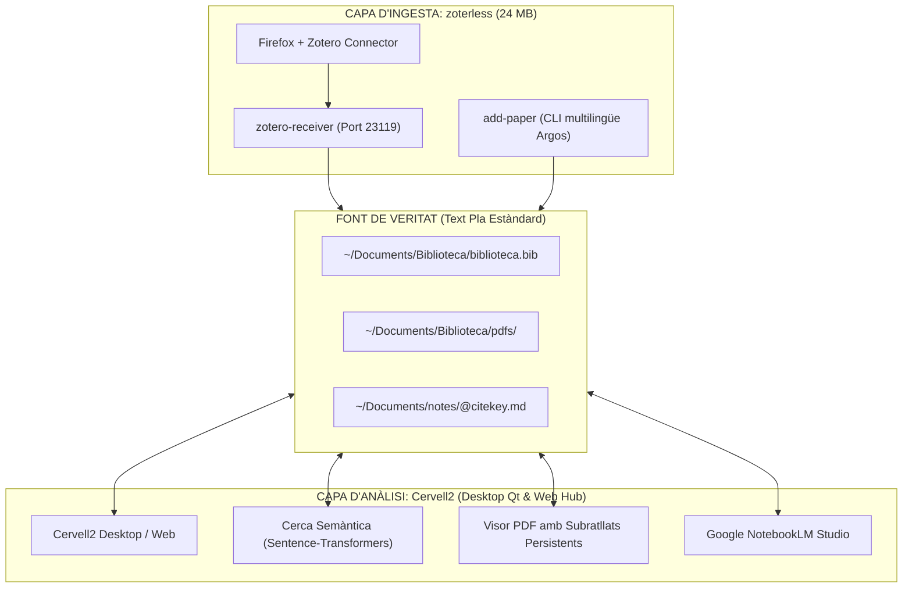

# ⚡ zoterless

> **Zero RAM, Zero SQLite, Zero Electron/Gecko. 100% Zotero Connector Compatible.**  
> *Una suite acadèmica minimalista basada en fitxers plans per a Linux (KDE Plasma, Kate, Okular).*

---

## 🎯 Per què zoterless?

La majoria d'investigadors i acadèmics que utilitzen fitxers plans (LaTeX, Markdown, Quarto, Typst) pateixen una paradoxa: per alimentar un simple fitxer `.bib` i una carpeta de PDFs han de mantindre oberta una aplicació feixuga de més de **500 MB de RAM** (Zotero Desktop, construït sobre el motor Gecko/Firefox) amb una pila d'extensions fràgils que sovint es desincronitzen o es trenquen amb les actualitzacions.

**zoterless** elimina completament Zotero Desktop, la base de dades SQLite i els connectors intermediaris, substituint-los per un dimoni natiu ultralleuger en Python (~24 MB) que escolta directament les peticions de l'extensió oficial **Zotero Connector** de Firefox i escriu **directament als teus fitxers plans**.

---

## 🔄 Taula d'Equivalències (Pila Feixuga vs zoterless)

| La pila pesada anterior | L'alternativa zoterless | Què fa exactament? |
| :--- | :--- | :--- |
| **Zotero Desktop** *(~500 MB RAM, SQLite, Gecko)* | **`zotero-receiver`** *(~24 MB RAM, 0% CPU)* | Emula el servidor local de Zotero al port `23119` per a **Zotero Connector**. |
| **Plugin Better BibTeX** *(motor JS intern)* | **Natiu a `zotero-receiver`** | Resolució canònica via Crossref/DOI i escriptura directa a `biblioteca.bib`. |
| **Plugins ZotMoov / ZotFile** *(reanomenar PDFs)* | **Natiu a `zotero-receiver`** | Descàrrega directa d'Unpaywall o detecció automàtica a `~/Downloads`. |
| **Plugins Better Notes / Markdown** | **Natiu a `zotero-receiver`** | Creació immediata de la plantilla de notes a `notes/@{citekey}.md`. |
| **VS Code + Extensions Zotero** *(cercador de cites)* | **`kate-citar`** *(PyQt5 natiu per a Kate)* | Cercador instantani de referències per inserir `@citekey` al cursor. |
| **Visor de PDFs intern de Zotero** | **`kate-citar-actions` + Okular** | Obre el PDF associat a **Okular** i la nota a **Kate** amb una drecera. |

---

## 🏗️ Arquitectura del Sistema



---

## ✨ Funcionalitats Clau

1. **100% Compatible amb Zotero Connector:**
   Fes clic a la icona oficial del Zotero Connector a Firefox com sempre. No cal tindre Zotero obert ni instal·lat.
2. **Resolució intel·ligent de DOI & Metadades Canòniques:**
   Quan afegeixes un article des de catàlegs de biblioteques (com Trobes UV, Primo VE, Dialnet) on les dades solen arribar incompletes, `zoterless` neteja el títol, consulta l'API de Crossref i obté les metadades oficials i canòniques de la revista.
3. **Descàrrega automàtica de PDFs en Accés Obert:**
   Mitjançant la integració nativa amb l'API d'**Unpaywall**, descarrega automàticament el PDF lliure i el reanomena a `pdfs/{citekey}.pdf`.
4. **Detecció intel·ligent a `~/Downloads`:**
   Si l'article requereix accés per subscripció universitària (EduVPN) i el descarregues tu mateix, `zoterless` examina els PDFs recents a la teua carpeta de descàrregues, n'analitza la primera pàgina amb `pdftotext` i l'associa automàticament.
5. **Captura des del visor de PDFs de Firefox:**
   Si estàs veient un PDF en línia o un fitxer local `file:///...` al navegador, només has de prémer la icona de Zotero Connector: el sistema n'extrau el DOI de la capçalera i en registra totes les metadades.
6. **Normalització Unicode (NFKD):**
   Els cognoms i títols amb accents (`Cáceres`, `innovación`) es transliteren de manera natural (`caceresTendenciasInnovacion...`) sense perdre caràcters ni corrompre les claus BibTeX.
7. **Notificacions Natives KDE:**
   Notificació d'escriptori immediata mitjançant `notify-send` informant de la citekey, l'estat del PDF i la nota creada.

---

## 📂 Estructura de Fitxers

`zoterless` organitza la teua biblioteca estrictament en fitxers estàndard:

```text
~/Documents/
├── Biblioteca/
│   ├── biblioteca.bib          # Base de dades canònica en text pla
│   └── pdfs/
│       ├── pont-niclosCreativityArtificialIntelligence2024.pdf
│       ├── berzosaInteligenciaArtificialPensamiento2025.pdf
│       └── caceresTendenciasInnovacionCurricular2026.pdf
└── notes/
    ├── @pont-niclosCreativityArtificialIntelligence2024.md
    ├── @berzosaInteligenciaArtificialPensamiento2025.md
    └── @caceresTendenciasInnovacionCurricular2026.md
```

---

## 🚀 Instal·lació

### 1. Requisits previs (Debian / Ubuntu / Kubuntu)
```bash
sudo apt install python3 python3-pyqt5 curl poppler-utils libnotify-bin
```

### 2. Clonar i instal·lar
```bash
git clone https://github.com/CasimirVictoria/zoterless.git ~/Projects/zoterless
cd ~/Projects/zoterless
chmod +x install.sh
./install.sh
```

L'instal·lador:
- Copia els binaris a `~/.local/bin/`.
- Configura i activa el servei d'usuari a `systemd` (`zotero-receiver.service`).
- El servei arrenca automàticament a cada inici de sessió consumint només **~24 MB**.

---

## ⚙️ Integració amb l'Editor Kate

Per a una experiència de recerca fluida a KDE Plasma:

### 1. Inserir citació (`kate-citar`)
- A Kate: **Configuració** → **Configura Kate** → **Eines externes** → **Afegeix**.
- **Nom:** `Citar BibTeX`
- **Ordre:** `kate-citar`
- **Drecera recomanada:** `Ctrl+Alt+C`
- En prémer la drecera, s'obre un cercador ràpid en PyQt5. En triar una entrada i prémer `Enter`, s'insereix `@citekey` directament al text.

### 2. Menú d'accions contextuals (`kate-citar-actions`)
- A Kate: **Eines externes** → **Afegeix**.
- **Nom:** `Accions de Citació`
- **Ordre:** `kate-citar-actions %{Document:Selection:Text}`
- **Drecera recomanada:** `Ctrl+Alt+O`
- Situa el cursor sobre qualsevol `@citekey` (o selecciona-la):
  - **Obrir PDF:** Obre el PDF canònic a **Okular**.
  - **Obrir Nota:** Obre la nota Markdown (`@{citekey}.md`) en una pestanya de **Kate**.

---

## 🛠️ Eines Addicionals

### `add-paper`: Gestor CLI i Cerca Federada Multilingüe
Permet afegir articles i cercar literatura acadèmica directament des del terminal o el portapapers (Wayland/X11):

```bash
# 1. Cerca federada multilingüe (OpenAlex, ERIC, Crossref, Dialnet) amb Argos Translate:
#    Tradueix localment català -> anglès (ERIC, OpenAlex, Crossref) i castellà (Dialnet),
#    executa cerques en paral·lel, deduplica resultats i mostra fonts combinades:
add-paper -s "pensament computacional a primària"

# 2. Afegir directament per DOI, arXiv o URL de repositori (Dialnet, RODERIC, RiuNet, etc.):
add-paper 10.18172/con.6302
add-paper https://arxiv.org/abs/2301.00001
add-paper https://dialnet.unirioja.es/servlet/articulo?codigo=6327318

# 3. Connectar automàticament a EduVPN UV abans de la descàrrega per a articles de pagament:
add-paper --vpn 10.1016/j.compedu.2023.104845

# 4. Mode autònom des del portapapers (llegeix automàticament el text copiat):
add-paper
```

### 🔒 Detecció Institucional d'EduVPN
Quan un article pertany a una editorial sota subscripció (ScienceDirect, Springer, Wiley, IEEE, etc.) i no té PDF lliure en accés obert, `zoterless` comprova l'estat d'EduVPN (`nmcli`):
- Si la VPN institucional no està activa, envia una notificació suggerint connectar-la (`nmcli con up eduvpn`).
- Suporta descàrrega directa a través del túnel VPN WireGuard un cop connectat.

---

## 🧬 Ecosistema i Integració amb Segon Cervell (Cervell2)

`zoterless` està dissenyat segons la **filosofia UNIX: fes una sola cosa i fes-la a la perfecció**. En lloc de convertir-se en un monòlit que ho faça tot, s'integra de forma nativa i desacoblada amb sistemes de gestió del coneixement personal (PKM) com **[Cervell2](https://github.com/CasimirVictoria/Cervell2)**:



- **`zoterless` s'encarrega de l'operació ràpida:** Ingesta instantània des de Firefox o terminal, resolució DOI canònica, descàrrega i normalització a fitxers plans.
- **`Cervell2` s'encarrega de la profunditat intel·lectual:** Reordenació semàntica dels resultats, lectura i subratllat vinculat a notes, connexió amb quaderns de NotebookLM i càlcul simbòlic.
- **Zero bloqueig (*No vendor lock-in*):** Si `Cervell2` no està obert, `zoterless` funciona al 100% de la seua potència. Si `zoterless` actualitza un document, `Cervell2` el detecta a l'instant perquè llegeixen els mateixos fitxers.

---

## 📄 Llicència

Distribuït sota la llicència [MIT](LICENSE). Desenvolupat amb passió pel programari lliure i la simplicitat de UNIX.
